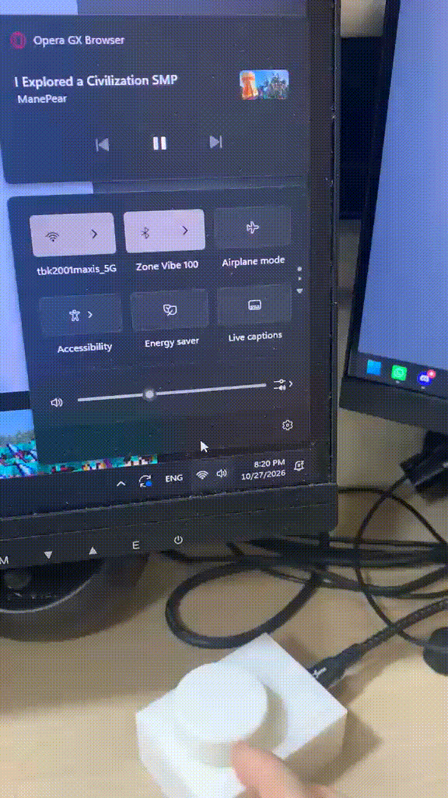

# Audio Control Device

This project is a custom USB-HID audio control device designed to provide physical volume and mute control for your computer.

## Bill of Materials
See the [BOM.md](BOM.md) file for a detailed list of required components.

## Documentation & Schematics
- **Flowchart.png**: System flow diagram.
- **Pinout.png**: Wiring and pin configuration.
- **Schematc.png**: Schematic diagram for the circuit.

## 3D Printed Parts
All models are located in the `3D Prints` directory:
- **Case.stl**: Main device case.
- **Case Dimensions.pdf**: Technical drawings for the case.
- **Cover.stl**: Device top cover.
- **Cover Dimensions.pdf**: Technical drawings for the cover.
- **Knob.stl**: Control knob.

## Programming
The microcontroller code is in `control.ino`.
Dependencies (Arduino IDE/PlatformIO):
- `Adafruit_TinyUSB`
- `RotaryEncoder`

To use:
1. Connect components as shown in `Pinout.png`.
2. Compile and upload `control.ino` to your microcontroller board.

